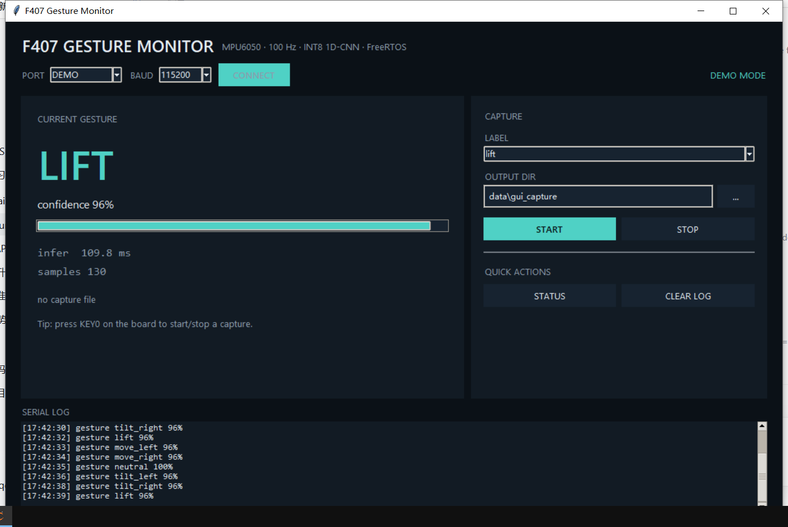

# STM32F407 Gesture AI — framework

On-device gesture recognition with a 6-axis IMU:

```text
MPU6050 (100 Hz) -> 2 s onset-aligned sequence -> 2:1 decimation (50 Hz)
                  -> INT8 1D-CNN (LiteRT Micro) -> OLED + UART
```

> **This repository ships the framework only.**  
> It does **not** include the gesture dataset, trained weights, normalization
> or quantization parameters, or the generated model C array.  Bring your own
> captures, train the model, and generate the firmware array.

## What is included

| Directory | Contents |
| --- | --- |
| [`firmware/`](firmware/) | STM32F407VET6 Keil project, FreeRTOS, LiteRT Micro, event segmentation, UART DMA, OLED. `g_gesture_model_data.c` is a placeholder. |
| [`training/`](training/) | Dataset builder, grouped evaluation, augmentation, INT8 export, C-array generator, F407 capture tool. |

## Host GUI

A small Tkinter monitor is included for demos and capture:

```bash
python training/gesture_gui.py --port COM6
python training/gesture_gui.py --demo    # no hardware
```



## Quick start

1. **Collect data** into `training/data/raw/` (or `data/raw_f407/`).  Each file
   is one gesture:
   `timestamp,ax,ay,az,gx,gy,gz,label` at 100 Hz.  `training/collect_f407.py`
   records F407 captures through the firmware's CSV mode.
2. **Train**:
   ```bash
   cd training
   python -m pip install -r requirements.txt
   python prepare_dataset.py \
     --raw-dir data/raw data/raw_f407 \
     --mode sequence --output-dir data/processed_mixed
   python train_keras_litert.py \
     --data-dir data/processed_mixed \
     --output-dir runs/my_model \
     --folds 0 --epochs 140 --augment basic \
     --oversample-domain raw_f407 --domain-repeat 3 --export
   ```
3. **Generate the firmware array**:
   ```bash
   python generate_model_c_array.py \
     runs/my_model/gesture_model_int8.tflite runs/my_model \
     --header-dir ../firmware/Core/Inc \
     --source-dir ../firmware/Core/Src
   ```
4. **Copy the trained constants** from `runs/my_model/report.json` into
   `firmware/Core/Src/gesture_preprocess.c`:
   `normalization_mean`, `normalization_std`, `INPUT_SCALE`,
   `INPUT_ZERO_POINT`.
5. Build `firmware/MDK-ARM/f407_gesture_ai.uvprojx` and flash.

Until steps 3–4 are done, the firmware still boots but logs
`gesture inference init failed`; the placeholder model is intentional.

## Reference design

The author's private dataset used 188 F103 captures plus 55 F407 captures.
With that data, the same pipeline reached INT8 97.4% on a 39-capture held-out
split (F407 subset 11/11), a capture-grouped 5-fold CV of 99.1% ±1.7%,
~110 ms per inference on the F407, a 20.1 KB INT8 model and 6.2 KB tensor
arena.  **Those artifacts and numbers are not included
here**; they depend entirely on your data and mounting.

## Hardware

| Function | Pin | Notes |
| --- | --- | --- |
| MCU | STM32F407VET6 | 168 MHz, 512 KB Flash, 128 KB SRAM |
| IMU | MPU6050 on I2C2: PB10/SCL, PB11/SDA | 0x68, ±2 g / ±250 °/s |
| Console | USART1: PA9/TX, PA10/RX | 115200 8N1, CH340 |
| OLED | SSD1306 on I2C1: PB8/SCL, PB9/SDA | 0x3C, optional |
| Button | KEY0 on PE4 | active low, toggles CSV capture |
| Debug | SWD: PA13/SWDIO, PA14/SWCLK | ST-Link V2 |

See [`firmware/README.md`](firmware/README.md) for the event pipeline, UART
protocol and model-update steps.

## License

Code is released under the [MIT License](LICENSE).  The dataset is **not**
included; any data you collect is yours.
